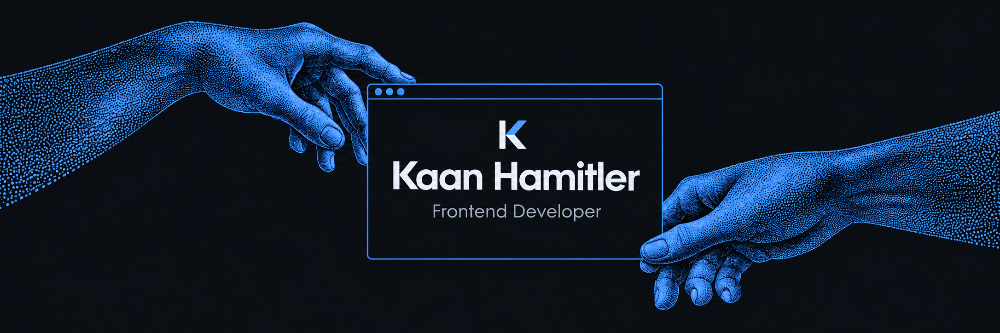
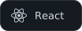
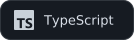
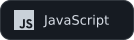
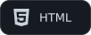
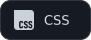
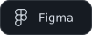
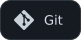
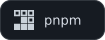
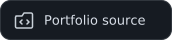

  

I Build interfaces with React, TypeScript and TailwindCss

## About

I started with HTML and CSS and moved into JavaScript and React through practice. I'm now developing my portfolio, from page sections and navigation to the contact flow.

My current focus is strengthening my JavaScript and React foundations, using TypeScript more confidently and improving form validation and error handling.

## Toolkit

**Frontend**

  
  
  
  
  
  

**Design &amp; development**

  
  
  
  

**Integrations I'm learning**

  
  

## Selected work

### [Portfolio](https://github.com/Kaan-Developer/Portfolio)

A personal website that brings my introduction, projects and contact details together. Built with React, TypeScript, Tailwind CSS and Vite.

- Site and project content organised in typed data files.
- A single-page layout with section links and responsive navigation.
- A separately loaded Spline scene with device and visibility checks.

**[View source →](https://github.com/Kaan-Developer/Portfolio)** · [Implementation notes](https://github.com/Kaan-Developer/Portfolio/blob/main/src/data/projects.ts)

The website is in development. The link above opens its source repository.

## Contact

For project feedback or a quick hello:

  
  
  

[kaandeveloperr07@gmail.com](mailto:kaandeveloperr07@gmail.com)
