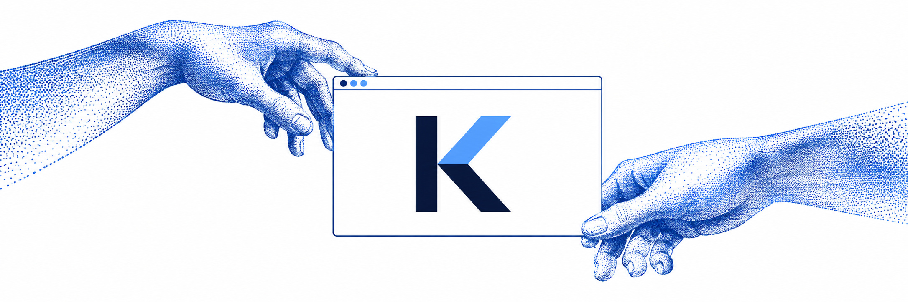

  

<h1 align="center">Kaan Hamitler</h1>

  <strong>Frontend Developer</strong> 
  Building clean, useful interfaces with React and TypeScript.

  <a href="mailto:kaandeveloperr07@gmail.com">Email</a>
  &nbsp;·&nbsp;
  <a href="https://github.com/Kaan-Developer/Portfolio">Portfolio source</a>

---

### About me

I started with HTML and CSS, then moved into JavaScript and React. Today, I’m developing my portfolio with TypeScript and Tailwind CSS, working on the interface, navigation and contact flow.

My current focus is strengthening my JavaScript and React foundations and getting more comfortable with TypeScript through practice.

### Stack

  
  
  
  
  
  
   
  React · TypeScript · JavaScript · Tailwind CSS · HTML · CSS

  
  
  
  
   
  Tools &amp; integrations: Git · Vite · pnpm · Supabase

### Featured work

<table width="100%">
  <tr>
    <td>
      <h3><a href="https://github.com/Kaan-Developer/Portfolio">Portfolio ↗</a></h3>
      
A personal website for my projects, background and contact details.

      <ul>
        <li>React sections with content kept in typed data files.</li>
        <li>A Spline scene with device and visibility checks.</li>
        <li>A contact form connected to Supabase and Resend.</li>
      </ul>
      
React · TypeScript · Tailwind CSS · Supabase

      

        <a href="https://github.com/Kaan-Developer/Portfolio"><strong>Explore the code →</strong></a>
        &nbsp;·&nbsp;
        <a href="https://github.com/Kaan-Developer/Portfolio/blob/main/src/data/projects.ts">Project decisions</a>
      

    </td>
  </tr>
</table>

---

  <a href="mailto:kaandeveloperr07@gmail.com">kaandeveloperr07@gmail.com</a>

