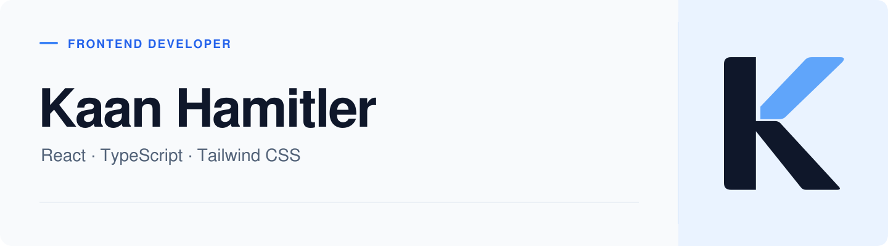

 

  <strong>Frontend Developer building thoughtful interfaces for the web.</strong>
    

  React · TypeScript · Tailwind CSS

 

  <a href="https://github.com/Kaan-Developer/Portfolio">View portfolio</a>
  &nbsp;·&nbsp;
  <a href="mailto:kaandeveloperr07@gmail.com">Get in touch</a>

---

<table>
<tr>
    <td width="50%" valign="top">
      <h2>About</h2>
      

        I build responsive frontend interfaces with clear structure, thoughtful interaction and maintainable code.
      

      

        My focus is React and TypeScript. I am also extending my work into backend-connected features with Supabase and Resend.
      

    </td>
    <td width="50%" valign="top">
      <h2>Projects</h2>
      

        <strong><a href="https://github.com/Kaan-Developer/Portfolio">Portfolio</a></strong>  

        A responsive React and TypeScript portfolio built with Vite and Tailwind CSS.
      

      

        Typed project data · Section navigation · Contact flow · Spline scene
      

      <a href="https://github.com/Kaan-Developer/Portfolio">View repository →</a>
    </td>
  </tr>
</table>

## Stack

  
  
  

 

  
  
  
  
  

 

  <a href="https://github.com/Kaan-Developer/Portfolio/blob/main/src/data/projects.ts">Explore project data →</a>

   
 

  <a href="mailto:kaandeveloperr07@gmail.com">kaandeveloperr07@gmail.com</a> · <a href="https://github.com/Kaan-Developer">GitHub</a>

