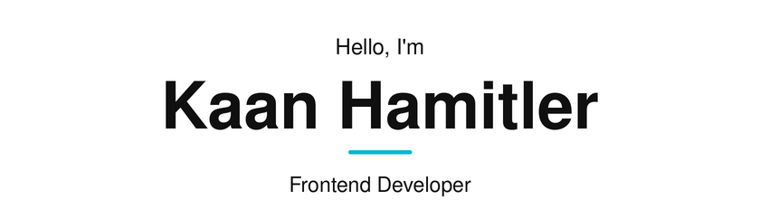
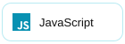

  
  <picture>  
    <source media="(prefers-reduced-motion: reduce)" srcset="./assets/profile-intro.svg">  
      
  </picture>  

  <h3 align="center">About</h3>  
  
  I build responsive interfaces with React, TypeScript and Tailwind CSS.   
  I'm improving my JavaScript foundations and turning what I learn into projects.  

     <h3 align="center">Skills</h3>  
  
    
    
    
    
     
    
    
    
    

  
  
  <a href="https://github.com/Kaan-Developer/Portfolio">Explore my portfolio →</a>  

  
  <picture>  
    <source media="(prefers-reduced-motion: reduce)" srcset="./assets/profile-intro.svg">  
      
  </picture>  

  <h3 align="center">About</h3>  
  
  I build responsive interfaces with React, TypeScript and Tailwind CSS.   
  I'm improving my JavaScript foundations and turning what I learn into projects.  

     <h3 align="center">Skills</h3>  
  
    
    
    
    
     
    
    
    
    

  
  
  <a href="https://github.com/Kaan-Developer/Portfolio">Explore my portfolio →</a>  

